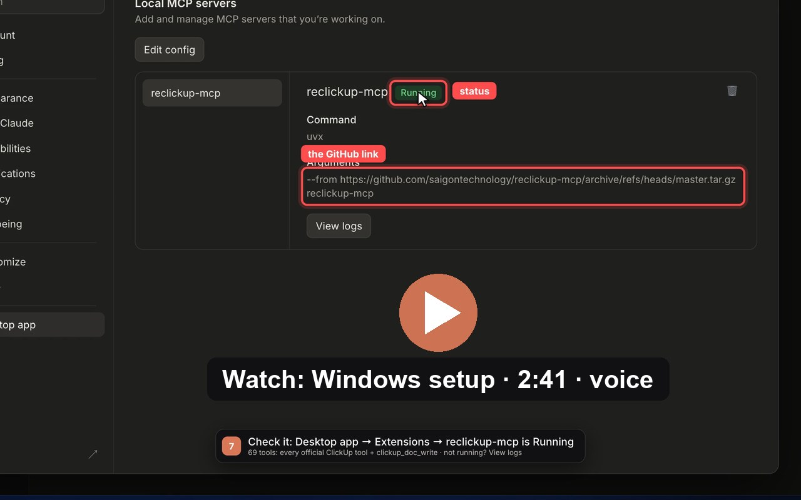

<div align="center">


# reclickup-mcp

**Every tool of the official ClickUp MCP, plus formatted tables written straight into a ClickUp Doc.**

<p>
  <a href="https://github.com/saigontechnology/reclickup-mcp/releases/latest"></a>
  
  
  
  
  <a href="LICENSE"></a>
</p>

<a href="https://pub-ad81218f6d26484ab3b7b9f714c38911.r2.dev/videos/reclickup-mcp-windows-setup.mp4"></a>

<sub>Setup on Windows with the new Claude Desktop settings: install from a downloaded reclickup-mcp.tar.gz, sign in, add the clickup-user-story skill, write a ticket into a Doc.</sub>

</div>

An MCP server that gives you **every tool of the official ClickUp MCP** plus one thing it cannot do:
**write formatted tables into a ClickUp Doc** — set column widths, green header cells, bold text —
straight from Markdown, with nothing to copy or paste.

- Proxies the official server (`mcp.clickup.com`), so its tools stay current: read and write tasks, Docs, comments, lists.
- `clickup_doc_write` fills a Doc page from Markdown in a headless Microsoft Edge: tables fitted to the Doc's 720 px column, green header cells, bold scenario titles.
- Installs from this repo with one `uvx` line. Nothing to clone.

## Why

ClickUp's public Docs API (and the official MCP's `create/update_document_page`) only accepts Markdown
or plain text. Tables written that way always get equal-width columns and no cell colours.

The Doc editor does accept a **paste** whose `text/html` carries each table as

```html
<span class="ql-table-embed" data-table-embed-value="BASE64(JSON table-embed)"></span>
```

That is what ClickUp itself puts on the clipboard when you copy a task description. Column widths,
`cell-bg-color`, bold, links and headings all survive, and the result is saved server-side.
reclickup builds that HTML and pastes it inside its own **headless Microsoft Edge**: no window and
no clipboard.

## Tools

| Tool | What it does |
| --- | --- |
| all `clickup_*` tools of the official server | Proxied unchanged from `https://mcp.clickup.com/mcp` through [`mcp-remote`](https://www.npmjs.com/package/mcp-remote), so they stay current. |
| `clickup_doc_write` | Writes into a Doc page (`page_url`) from `markdown` (or a Quill `delta`). `mode` is `replace` (default) or `append`. If the page is untitled, it is named after the first `# ` line. Reloads the page and returns the widths, green cells and alignment of every table. Takes about 25 s. |
| `clickup_relogin` | Refreshes the ClickUp session of reclickup's headless browser. |

### Markdown it understands

- Headings `#`, `##`, `###` (the first `# ` line names an untitled page and is not written into the body).
- Paragraphs, `**bold**`, `*italic*`, `` `code` ``, `~~strike~~`, `[links](url)`, `> quotes`.
- Lists: `- bullet`, `1. ordered`, `- [ ]` / `- [x]` checklists, nested with two spaces.
- Pipe tables, with `<br>` for line breaks and `\|` for a literal pipe in a cell.
- Backslash escapes (`\_`, `\#`, …) as written by ClickUp's own markdown export, so a page read with
  `clickup_get_document_pages` can be edited and written back.

Every table gets a bold header row with green background cells. A table whose first header cell is
`User Story Name` is a key/value table: its first column is styled instead. Lines starting with
`Scenario <n>` in a cell are bold. Columns are sized to the Doc's 720 px text column. Presets cover the
common user-story tables (`md2delta.py` / `delta2doc.py`); any other table is scaled proportionally.

### Errors that mean "retry"

Every call answers within ~50 s (Claude Desktop and Cowork give up on a call to your computer after 60 s).

| Error | Meaning |
| --- | --- |
| `NOT_READY` | The official server is still connecting, or waits for the ClickUp sign-in in the browser. Nothing was sent. |
| `STALE_CONNECTION` | The connection to ClickUp had stopped answering (network or VPN change); reclickup restarted it. |
| `BUSY` | Another Doc write or sign-in is using reclickup's browser. |
| `NOT_LOGGED_IN` / `LOGIN_PENDING` | reclickup's browser needs a ClickUp session: call `clickup_relogin` (again). |
| `TIMEOUT` | The Doc page did not load in time; nothing was pasted. |

Read-only official tools are retried once on a network blip; writes never are.

## How it works

- **Proxy:** `reclickup_mcp/server.py` speaks MCP over stdio. It starts `npx -y mcp-remote@0.15.1 https://mcp.clickup.com/mcp`,
  forwards `tools/list`, `tools/call`, `resources/*` (the official tools' MCP Apps views, e.g. the task card of
  `clickup_get_task`) and `prompts/*`, and adds its own tools. Each request runs in its own thread, so a slow Doc
  write does not block other calls. Until the official server connects, the tool list comes from the last one seen
  (or a snapshot shipped in the package). A call slower than 20 s triggers a ping; a dead connection is restarted.
- **Browser:** `reclickup_mcp/browser.py` runs a private headless Edge on port **9335** with its own profile
  (`~/.reclickup/headless-profile`). It starts on demand and stops after 10 minutes idle
  (`RECLICKUP_IDLE_STOP`). Claude Desktop may start several copies of reclickup; they share that Edge through a
  lock file (`~/.reclickup/browser.lock`), so one copy never closes it under another's write.
- **Session:** the ClickUp session (`cu_jwt` cookie) is copied once into that profile:
  - **macOS:** from a running debug Edge on `:9222` if one is signed in, else decrypted from your
    real Edge profile. Keychain asks once for "Microsoft Edge Safe Storage": click Allow.
  - **Windows:** `clickup_relogin` opens an Edge window at the ClickUp login. Sign in once; the
    profile keeps the session.

## Install

### Let an AI agent do it

Paste one of these into **Claude Code** (or a Claude Desktop task with shell access) on the machine to set up.

<details>
<summary><b>Prompt 1: install reclickup-mcp for me</b></summary>

```text
Install the reclickup-mcp MCP server for Claude Desktop on this computer, following
https://github.com/saigontechnology/reclickup-mcp (read its README first). Talk to me in my language.

1. Check the requirements: uv (uvx), Node.js (npx) and Microsoft Edge. Install what is missing
   (uv: the official one-line installer; Node: winget on Windows, brew on macOS) and tell me what you installed.
2. Find Claude Desktop's config. macOS: ~/Library/Application Support/Claude/claude_desktop_config.json, or
   Claude-3p/ next to it when Desktop runs through an organization gateway. Windows: %APPDATA%\Claude\,
   %LOCALAPPDATA%\Claude-3p\, or %LOCALAPPDATA%\Packages\Claude_*\LocalCache\Roaming\Claude\ for the Store app.
   If the file has "deploymentMode": "3p", the Claude-3p one is in use. Back the file up, then add ONLY this entry
   under "mcpServers", keeping every other key; write UTF-8 without a BOM:
     "reclickup-mcp": { "command": "uvx",
       "args": ["--from",
         "https://github.com/saigontechnology/reclickup-mcp/archive/refs/heads/master.tar.gz",
         "reclickup-mcp"] }
   (macOS: if Desktop cannot find uvx, use the full path from `which uvx`.)
3. Pre-fetch it: uvx --from https://github.com/saigontechnology/reclickup-mcp/archive/refs/heads/master.tar.gz python -c "import reclickup_mcp"
4. Ask me to quit Claude Desktop completely (tray / menu bar icon -> Quit) and reopen it. Do not kill it yourself.
   Then Settings -> Desktop app -> Extensions: Manage -> Local MCP servers must show reclickup-mcp "Running"
   (typing "developer" in the Settings search also opens that page).
5. Tell me to start a Claude Desktop task, type "log in to ClickUp", and in the browser page that opens pick the
   workspace and click "Connect Workspace".
6. Download https://github.com/saigontechnology/reclickup-mcp/releases/latest/download/clickup-user-story.zip and
   tell me where it is: Claude Desktop -> Customize -> Skills -> + -> Upload skill.
7. Report what you changed (config file path, backup path) and what I still have to do.
```

</details>

<details>
<summary><b>Prompt 2: check for an update and update it</b></summary>

```text
Check whether reclickup-mcp (https://github.com/saigontechnology/reclickup-mcp) on this computer is up to date,
and update it if not. Talk to me in my language.

1. Latest version: the newest commit on master
   (https://api.github.com/repos/saigontechnology/reclickup-mcp/commits/master) and the latest release.
2. Installed version: the "reclickup-mcp" entry in Claude Desktop's claude_desktop_config.json (see the README for
   where it lives; check Claude-3p too). If it is missing, stop and offer to install it instead. If it points at a
   downloaded reclickup-mcp.tar.gz, download the latest one over it. If it points at an old reclickup-mcp.tgz
   (newer uv refuses the .tgz name), download reclickup-mcp.tar.gz to the same folder, change the path in the
   config to it and delete the .tgz. If it is pinned to an old tag or commit, tell me before changing it.
3. Update the cached build:
   uvx --refresh --from <the --from value in the config> python -c "import reclickup_mcp"
4. Ask me to quit Claude Desktop completely (do not kill it yourself), then run
   tools/enable_desktop_tools.py from the repo
   (https://raw.githubusercontent.com/saigontechnology/reclickup-mcp/master/tools/enable_desktop_tools.py):
   first without arguments; if it lists disabled reclickup tools, run it again with --apply. Delete the script after.
5. Ask me to reopen Claude Desktop and check Settings -> Desktop app -> Extensions (Local MCP servers):
   reclickup-mcp "Running".
6. Skill: download the latest
   https://github.com/saigontechnology/reclickup-mcp/releases/latest/download/clickup-user-story.zip and tell me to
   replace the clickup-user-story skill (Customize -> Skills: delete the old one, Upload skill). For Claude Code,
   unzip it over ~/.claude/skills/clickup-user-story yourself.
7. Report: old -> new version, what changed (the commit messages since the old version), what I still have to do.
```

</details>

### By hand


Nothing to clone, no Git needed. [`uv`](https://docs.astral.sh/uv/) fetches the server straight from this repo,
installs its dependencies in a cached environment, and downloads Python itself if needed.

Requirements: **uv**, **Node.js** (for `npx`), **Microsoft Edge**.

```bash
# macOS / Linux
curl -LsSf https://astral.sh/uv/install.sh | sh
# Windows (PowerShell)
powershell -ExecutionPolicy ByPass -c "irm https://astral.sh/uv/install.ps1 | iex"
```

### Claude Desktop

Open **Settings → Desktop app → Extensions: Manage → Local MCP servers → Edit config** (or type `developer` in the
Settings search), add this to `claude_desktop_config.json`, save, then quit Claude Desktop completely and reopen it:

```json
{
  "mcpServers": {
    "reclickup-mcp": {
      "command": "uvx",
      "args": ["--from",
        "https://github.com/saigontechnology/reclickup-mcp/archive/refs/heads/master.tar.gz",
        "reclickup-mcp"]
    }
  }
}
```

The same entry works on macOS and Windows (`uvx` is a real executable, no `cmd /c` needed).

<details>
<summary><b>Can't reach GitHub from Claude Desktop? Install from a downloaded file</b></summary>

1. Download [`reclickup-mcp.tar.gz`](https://github.com/saigontechnology/reclickup-mcp/releases/latest/download/reclickup-mcp.tar.gz)
   from the latest release and keep it somewhere it will stay, for example `Downloads`.
2. Put the file's full path in `--from` (`~` and `%USERPROFILE%` are not expanded):

   ```json
   "reclickup-mcp": {
     "command": "uvx",
     "args": ["--from", "C:\\Users\\<you>\\Downloads\\reclickup-mcp.tar.gz", "reclickup-mcp"]
   }
   ```

   Write every `\` as `\\` in JSON. On macOS: `"/Users/<you>/Downloads/reclickup-mcp.tar.gz"`. A path with spaces is fine.
   Keep the `.tar.gz` name: newer uv versions refuse a `.tgz` file ("non-PEP 625-compliant filename").
3. Quit Claude Desktop completely and reopen it. uv still downloads the dependencies (and Python if needed) on the first start.

To update later, download the new file over the old one and run `uvx --refresh --from <that path> python -c "import reclickup_mcp"` once.

</details>

If Claude Desktop cannot find `uvx` or `npx`, use the full path to `uvx` (`which uvx`, e.g.
`/Users/you/.local/bin/uvx`) and add `"env": { "PATH": "/opt/homebrew/bin:/usr/local/bin:/usr/bin:/bin" }`
so the path reaches `node`/`npx`.

#### Troubleshooting

Claude Desktop's log (`mcp-server-reclickup-mcp.log` in Desktop's `logs` folder) says *Server started and
connected successfully*, then *Server transport closed unexpectedly* a second later? `uvx` could not get the
package. The real error is in the `uvx` lines just above:

| `uvx` error | Fix |
| --- | --- |
| `non-PEP 625-compliant filename; only .tar.gz and .zip archives are accepted` | The downloaded file is named `.tgz`. Use `reclickup-mcp.tar.gz` (or rename it) and update the path. |
| `Git executable not found` | The `--from` value starts with `git+`. Remove `git+`: the `.tar.gz` link above needs no Git. |
| `Failed to resolve --with requirement` | Delete any `--with …` arguments; the entry needs only `--from <source> reclickup-mcp`. |

### Claude Code

```bash
claude mcp add reclickup-mcp -- uvx --from https://github.com/saigontechnology/reclickup-mcp/archive/refs/heads/master.tar.gz reclickup-mcp
```

### First run

- **Official ClickUp tools:** after the restart, start a task and ask Claude something like
  *"log in to ClickUp"*. That opens a browser tab for the official ClickUp MCP: pick your workspace
  and click **Connect Workspace**. The token is cached in `~/.mcp-auth`. Until you approve, only reclickup's
  own tools are listed; the full list appears right after.
- **`clickup_doc_write`:** needs a ClickUp session in reclickup's browser. On macOS it is copied
  automatically. On Windows, call `clickup_relogin` once and sign in in the window it opens.

### Updating

`uvx` caches the build. To pick up a newer commit, run `uvx --refresh --from https://github.com/saigontechnology/reclickup-mcp/archive/refs/heads/master.tar.gz python -c "import reclickup_mcp"`
once (with the same `--from` value as in your config), then restart Claude Desktop.

## Skill: clickup-user-story

[`skills/clickup-user-story/SKILL.md`](skills/clickup-user-story/SKILL.md) is a Claude skill built on
this server. It turns a BA user-story spec into a clean draft ticket and publishes it in a fixed team
style: 840 px tables with set column widths, green header cells and bold scenario titles.

- **As a task:** created through the official tools.
- **On a Doc page:** written with `clickup_doc_write`. Give it the Doc page link and the page is
  filled in directly.
- **Edit a Doc page:** reads the page, changes what you ask (e.g. a new scenario under Acceptance
  Criteria) and writes it back with the same formatting.
- **Fix:** it also repairs existing tickets whose tables came out half width.

**Download:** [clickup-user-story.zip](https://github.com/saigontechnology/reclickup-mcp/releases/latest/download/clickup-user-story.zip)

- **Claude Desktop / claude.ai:** Settings → Capabilities → Skills → **Upload skill**, then pick the zip.
- **Claude Code:**

  ```bash
  curl -fsSL -o /tmp/clickup-user-story.zip \
    https://github.com/saigontechnology/reclickup-mcp/releases/latest/download/clickup-user-story.zip
  rm -rf ~/.claude/skills/clickup-user-story && unzip -q /tmp/clickup-user-story.zip -d ~/.claude/skills
  ```

  The skill is a folder: `SKILL.md` plus `scripts/` (the converters it runs) and `reference/`.

Then ask, for example: *"make a ticket from this spec into https://app.clickup.com/…/v/dc/…/…"*.
The skill reads the workspace from the link, or asks which list or Doc to use.

## Environment variables

| Variable | Default | |
| --- | --- | --- |
| `RECLICKUP_PORT` | `9335` | CDP port of the headless Edge |
| `RECLICKUP_IDLE_STOP` | `600` | Seconds of inactivity before the headless Edge is closed |
| `RECLICKUP_BROWSER` | auto | Path to the Edge executable |
| `RECLICKUP_EDGE_PROFILE` | `~/Library/Application Support/Microsoft Edge/Default` | Real Edge profile to copy the session from (macOS) |
| `RECLICKUP_CALL_BUDGET` | `50` | Seconds a call to an official tool may take before it answers `NOT_READY` (clients drop calls after ~60 s) |
| `RECLICKUP_LOGIN_WAIT` | `40` | Windows: seconds `clickup_relogin` waits for the sign-in before answering `LOGIN_PENDING` |
| `RECLICKUP_SLOW_CALL` | `20` | Seconds before a slow official call triggers a connection check |
| `RECLICKUP_SAVE_WAIT` | `4` | Seconds `clickup_doc_write` lets ClickUp save before reloading to verify |
| `RECLICKUP_NPX` | `npx` on `PATH` | `npx` to run `mcp-remote` |
| `RECLICKUP_UPSTREAM` | `https://mcp.clickup.com/mcp` | Upstream MCP URL |

Upstream (`mcp-remote`) stderr is logged to `~/.reclickup/upstream.log` (rotated at 2 MB).

## Development

```bash
python -m pip install websocket-client
python -m unittest discover -s tests -v
```

The tests need no ClickUp account: `tests/fake_upstream.py` stands in for the official server (hung, dead, wedged,
slow, flaky, Vietnamese text). CI runs them on Linux, macOS and Windows. `skills/clickup-user-story/scripts/` holds
copies of `md2delta.py` and `delta2doc.py`; a test fails if they drift from the package.

## Troubleshooting

**Claude says it has no tool to create, update or get a task.** Claude Desktop may have switched off the official
tools that come with an MCP Apps view (`clickup_create_task`, `clickup_get_task`, `clickup_update_task`,
`clickup_filter_tasks`, `clickup_search`, the timers): `main.log` shows `Filtering out disabled tool "clickup_create_task"`.
reclickup lists those tools without the view since 0a1f140, but a switch already stored stays off. Quit Claude Desktop, then:

```bash
curl -fsSL -o enable_desktop_tools.py https://raw.githubusercontent.com/saigontechnology/reclickup-mcp/master/tools/enable_desktop_tools.py
python enable_desktop_tools.py            # shows what is switched off
python enable_desktop_tools.py --apply    # switches it back on
```

## Caveats

- `clickup_doc_write` relies on how ClickUp's web editor handles a paste, not on a public API.
  It can break if ClickUp changes the editor. The read-back check after each write reports
  that right away.
- Doc pages and tasks are different editors. `clickup_doc_write` only targets Doc pages
  (`/v/dc/…` or `/docs/…` links).

## License

MIT
